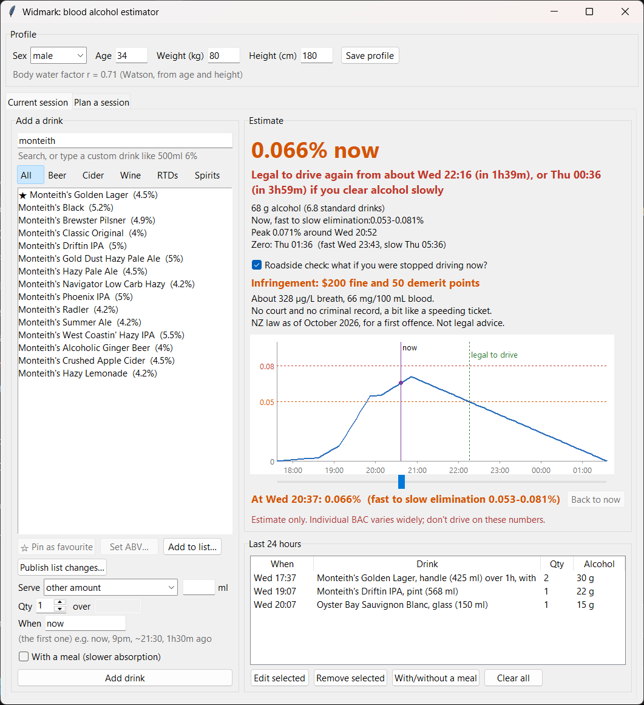

# Widmark

A desktop app and command-line tool that estimate blood alcohol concentration (BAC)
over time from the drinks you've had, using the Widmark formula. It ships with a
New Zealand drink list sourced from retailers and breweries, says when you'd be back
under the legal driving limit, and shows what NZ drink-driving law would mean at a
given reading.

> **Estimate only.** Individual BAC varies widely. Never use this to decide whether
> you're fit to drive.



## Features

- **Live estimate and chart.** Log drinks as you go and see your current BAC, the
  peak, and when it falls below 0.08%, 0.05% and zero, charted over time with a
  fast-to-slow elimination range. A slider reads the estimate off any point on the
  chart.
- **Legal-to-drive time.** When you'd be under the NZ limit for your age (0.05%, or
  zero under 20) at the typical elimination rate, with the later time for a slow one.
- **Roadside check.** The infringement or court outcome NZ law sets for a first
  offence at that BAC, from NZTA and Community Law pages (listed in `roadside.py`).
  Not legal advice.
- **Session planning.** A separate tab for drinks you mean to have (`sat 8pm`,
  `in 2h`, up to a week ahead), estimated on its own so it never mixes with what
  you've actually had.
- **NZ drink catalogue.** Beers, ciders, wines, RTDs and spirits with their serving
  sizes, built from the ABVs Liquorland, Woolworths, New World, PAK'nSAVE and the
  breweries themselves list. Conflicts between retailers are flagged, and a
  brewery's own figure (or one checked by hand) wins.
- **Forgiving input.** Times like `now`, `9pm`, `~21:30` or `1h30m ago`; drinks
  with food absorb more slowly; several of a drink can be spread over a time span.
- **Profile-aware.** With age and height, body water comes from the Watson formula
  rather than a fixed Widmark factor.
- **Maintainable data.** ABVs can be corrected and new drinks added in the app.
  Those edits become a reviewed pull request against the drink list, made in a
  separate git worktree so local work is never touched.

## How the estimate works

The Widmark formula gives the peak BAC from the grams of alcohol and the body
water that holds it:

```
BAC = alcohol (g) / (body weight (g) × r) × 100  −  elimination rate × hours
```

`r` is the fraction of body weight that is water: a fixed factor by sex, or from
the Watson formula when age and height are known. The app steps through time a
minute at a time: each drink is absorbed at a steady rate over 45 minutes (90 with
food), and the body clears a constant 0.015% per hour while BAC is above zero
(0.010–0.020% for the slow and fast range). These constants are commonly quoted
values that haven't been checked against a specific source, which is one reason
the app shows a range rather than a single answer.

## Getting started

Needs Python 3.10+ with Tkinter and
[uv](https://docs.astral.sh/uv/). There are no third-party dependencies.

```
uv run app.py
```

On Windows, `widmark.bat` opens the app without a console window. Your profile,
the last 24 hours of drinks and your plan are saved to `~/.widmark/state.json`.

### Command line

```
uv run bac.py -w 80kg --sex male --at 08:00 -d "2x pint 5% @20:00" -d "glass 13% @22:30" -d "shot @00:30"
```

Drinks are `[N x] SIZE [ABV%] @HH:MM`, where SIZE is mL, oz or a preset (pint,
schooner, can, bottle, glass, shot). Times roll past midnight. `--food` slows
absorption and `--chart` prints an hourly timeline; `uv run bac.py -h` lists
everything.

## Project layout

| File | What it does |
| --- | --- |
| `bac.py` | The model: Widmark and Watson, absorption and elimination, time parsing, and the CLI |
| `app.py` | The Tkinter desktop app |
| `roadside.py` | NZ limits and penalties for a given BAC and age |
| `build_drinks.py` | Builds `drinks.json` from `data/abv_sources.csv`, reconciling the sources' ABVs |
| `publish.py` | Turns drink list edits made in the app into a pull request |

## Testing

```
uv run python -m unittest
```

The suite covers the model, the time parser, the catalogue build, the penalty
rules, the publish flow (against throwaway git repos) and the app itself.

## Licence

No licence is granted. The code is published to read, and all rights are reserved.
